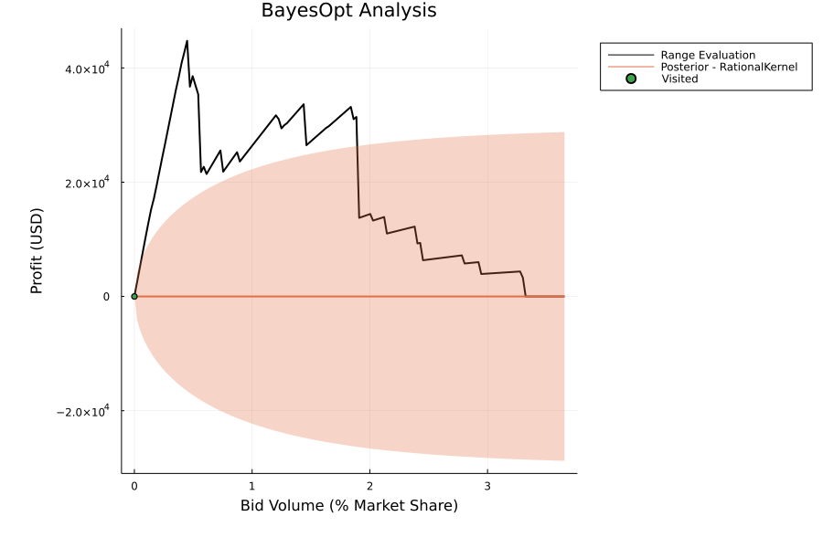

<div align="center">

# OptimalBids.jl

<p><sub><b>BILEVEL DECISIONS · MARKET CLEARING · SEARCH OVER OFFERS</b></sub></p>

[](https://andrewrosemberg.github.io/OptimalBids.jl/stable) [](https://andrewrosemberg.github.io/OptimalBids.jl/dev) [](https://codecov.io/gh/andrewrosemberg/OptimalBids.jl) [](https://github.com/invenia/BlueStyle) [](https://github.com/SciML/ColPrac)

</div>

<p align="center">
  <picture>
    <source media="(max-width: 640px)" srcset="docs/src/assets/diagrams/optimalbids--market-compact.svg">
    
  </picture>
</p>
<p align="center"><i>A market is built once; each offer is written into the network, cleared by an optimal power flow and scored, and the same market object serves evaluation, local and exact access.</i></p>

An offer is scored only after a market operator clears it, so the profit of a candidate offer is a function of another
agent's optimization. OptimalBids.jl reduces a market to four operations (building it, changing the offers, clearing,
and computing profit), so that derivative-free search, gradient search and exact bilevel reformulations act on one
market definition.

## Installation

```julia
] add OptimalBids
```

## PowerModels-Markets Example

In order to exemplify some of the functionalities available, let's use the interface with [PowerModels.jl](https://github.com/lanl-ansi/PowerModels.jl) implemented in the submodel `PowerModelsMarkets`.


```julia
using OptimalBids
using OptimalBids.PowerModelsMarkets
using HiGHS # Market Clearing Solver
using Plots # For some evaluation plots at the end

#=
CASE DEFINITION
=#

# Read market data from IEEE 118 bus case
case_name = "case118.m"
network_data = PowerModels.parse_file(case_name)

# Pretend we are a company constructing a new set of generators in the grid.
# Choose a percentage of the total number of buses to install the new generators:
percentage_buses = 0.09

# We need the keys PowerModels uses to reference the appropriate buses in it's network data dictionary.
# First, find out all available keys:
bus_indexes = collect(keys(network_data["bus"]))
# Then, calculate number of buses that consitute the chose percent (`percentage_buses`):
num_buses = length(bus_indexes)
num_strategic_buses = ceil(Int, percentage_buses * num_buses)
# To avoid any biases let's grab some generators in the middle:
bus_indexes = bus_indexes[21:(21 + num_strategic_buses - 1)]
# Finally, add new generators to the network grid data and collect their reference keys.
generator_indexes = [
    add_generator(network_data, parse(Int, bus_idx)) for bus_idx in bus_indexes
]

#=
PACKAGE USAGE
=#

# Define market
market = build_market(
    PowerModelsMarket,
    network_data,
    generator_indexes,
    HiGHS.Optimizer,
)

# New generators are added with 0.0 max capacity (a.k.a bid/offer), so lets change their volume offers:
initial_bids = rand(num_strategic_buses)
change_bids!(market, initial_bids)

# Now we can simulate the market:
clear_market!(market)

# and evaluate the gross profit (and cleared volums and prices):
calculate_profit(market)

# To avoid hassle, we made a function that calculates profit for any set of bids/offers:
new_bids = rand(num_strategic_buses)
profit_for_bid!(market, new_bids)

# and a function to evaluate a vector of possible bids sequentially:
range_mul_factor = 0.0:0.1:15.0
bid_range = [initial_bids .* [i] for i in range_mul_factor]
p_curve = profit_curve!(market, bid_range)

# Let's plot and see how the range profit evaluatiuon went:
plot(collect(range_mul_factor), p_curve,
    title="Case $case_name",
    label="Range Evaluation - Random Offers",
    ylabel="Profit (\$)",
    xlabel="Multiplicative Factor",
    legend=:outertopright,
)
```

<p align="center">
  
</p>
<p align="center"><sub><b>Surrogate search along one offer direction.</b> Bayesian optimization of producer profit on IEEE 118 with DC clearing,
all offered quantities scaled by one factor; points are clearings and the band is the Gaussian-process posterior. Profit
jumps wherever the active set of the clearing changes, which is what makes the search hard. From the
<a href="https://andrewrosemberg.github.io/OptimalBids.jl/stable/examples/Nonconvex/">Nonconvex.jl example</a>.</sub></p>

## Design

A market is a subtype of the abstract type `Market` that implements four functions; these are what a new market type
has to provide (see the docstrings, e.g. `@doc change_bids!`):

| Function | What it does |
|:--|:--|
| `build_market` | builds the market once from its data and a solver |
| `change_bids!` | writes the strategic agent's offers into the market |
| `clear_market!` | clears the market (for `PowerModelsMarket`, an optimal power flow) |
| `calculate_profit` | returns the cleared volumes, clearing prices and per-offer profit |

The functions `profit_for_bid!` and `profit_curve!` are built on these four in a generic way, so they evaluate any new
market without further code (see e.g. `@doc profit_for_bid!`). `PowerModelsMarket` clears by optimal power flow in the
PowerModels formulation passed as `market_formulation` (DC by default, AC, or any other), so linear and nonlinear
clearing of one network differ in a single argument. The same market object gives three kinds of access:

| Access | Function | Returns |
|:--|:--|:--|
| Evaluation | `profit_for_bid!(market, u)` | the profit $J(u)$, one clearing per call |
| Local | `profit_and_gradient_for_bid!(market, u)` | $J(u)$ and a price-based estimate of $\partial J/\partial u$ (prices held fixed; also a ChainRules rule) |
| Exact | `instantiate_model(market; jump_model = Lower(model))` | the clearing as the lower level of a BilevelJuMP model |

The [documentation](https://andrewrosemberg.github.io/OptimalBids.jl/stable) has the notation, the three access modes
in detail, and worked examples with Optim.jl, Nonconvex.jl and AbstractGPs.jl.

## Citation

For the methods, cite the strategic-bidding paper:

```bibtex
@article{rosemberg2025strategic,
  title   = {Strategic bidding in energy markets with gradient-based iterative methods},
  author  = {Rosemberg, Andrew and Pacaud, Fran{\c{c}}ois and Dias Garcia, Joaquim and Parker, Robert B. and Sundar, Kaarthik and Bent, Russell and Van Hentenryck, Pascal},
  journal = {Sustainable Energy, Grids and Networks},
  volume  = {43},
  pages   = {101878},
  year    = {2025},
  doi     = {10.1016/j.segan.2025.101878}
}
```
