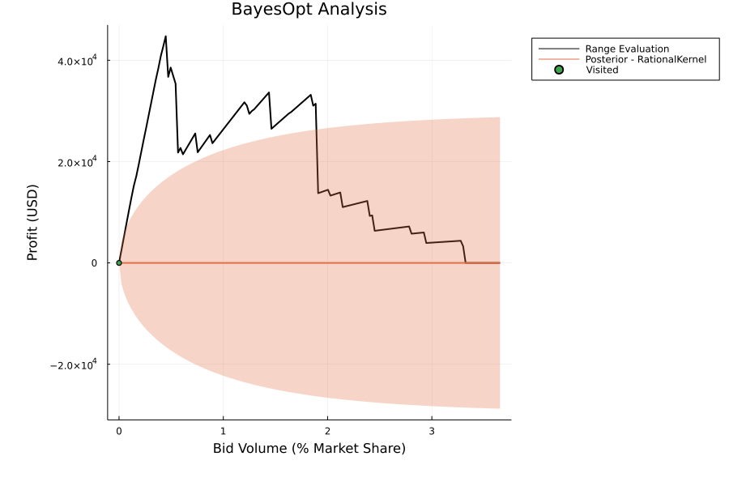

```@meta
CurrentModule = OptimalBids
```

# OptimalBids.jl

```@raw html
<p class="eyebrow">Bilevel decisions · Market clearing · Search over offers</p>
<figure class="fig hero">
  <picture>
    <source media="(max-width: 640px)" srcset="assets/diagrams/optimalbids--market-compact.svg">
    
  </picture>
  <figcaption><i>A market is built once; each offer is written into the network, cleared by an optimal power flow and scored, and the same market object serves evaluation, local and exact access.</i></figcaption>
</figure>
<p class="lede">An offer is scored only after a market operator clears it, so the profit of a candidate offer is a function of another agent's optimization. OptimalBids.jl reduces a market to four operations (building it, changing the offers, clearing, and computing profit), so that derivative-free search, gradient search and exact bilevel reformulations act on one market definition.</p>
<p><a class="github-button" href="https://github.com/andrewrosemberg/OptimalBids.jl" data-icon="octicon-star" data-show-count="true" aria-label="Star andrewrosemberg/OptimalBids.jl on GitHub">Star</a>
<script async defer src="https://buttons.github.io/buttons.js"></script></p>
```

## Installation

```julia
] add OptimalBids
```

## A market is four functions

A market is a subtype of the abstract type `Market` that implements four functions; these are what
a new market type has to provide (see the docstrings, e.g. `@doc change_bids!`):

| Function | What it does |
|:--|:--|
| [`build_market`](@ref) | builds the market once from its data and a solver |
| [`change_bids!`](@ref) | writes the strategic agent's offers into the market |
| [`clear_market!`](@ref) | clears the market (for `PowerModelsMarket`, an optimal power flow) |
| [`calculate_profit`](@ref) | returns the cleared volumes, clearing prices and per-offer profit |

The functions [`profit_for_bid!`](@ref) and [`profit_curve!`](@ref) are built on these four in a
generic way, so they evaluate any new market without further code (see e.g. `@doc profit_for_bid!`).
Search methods compared through them share the same evaluation and can be charged per clearing.

### The clearing is a PowerModels formulation

`PowerModelsMarket` adds strategic generators to a PowerModels.jl
network with `add_generator` (zero cost, zero capacity), treats their maximum outputs as the offered
quantities, and clears by optimal power flow in the formulation passed as `market_formulation`: DC
power flow by default, AC power flow, or any other PowerModels formulation, with the problem builder
passed as `opf_builder`. Linear and nonlinear clearing of one network therefore differ in a single argument.

### Notation

The diagram above and the examples use the following symbols.

| Symbol | In the code | Meaning |
|:--|:--|:--|
| ``\mathcal S`` | `market.strategic_generators` | the strategic generators |
| ``u_i`` | `new_bids[i]` | offered quantity of generator ``i`` (its `pmax`) |
| ``q_i^\star(u)`` | `calculate_profit(market).cleared_volumes[i]` | cleared output of generator ``i`` |
| ``\pi_i^\star(u)`` | `calculate_profit(market).clearing_prices[i]` | price at the bus of generator ``i`` |
| ``J(u)`` | `profit_for_bid!(market, u)` | total profit of the offer ``u`` |

so that

```math
J(u) = \sum_{i\in\mathcal S} q_i^\star(u)\,\pi_i^\star(u).
```

The price ``\pi_i^\star`` is the multiplier of power balance at the generator's bus; `calculate_profit`
reads it as `-lam_kcl_r`, the dual that PowerModels reports, with its sign flipped.

### One market, three kinds of access

- **Evaluation.** [`profit_for_bid!`](@ref) costs one clearing per call and serves derivative-free
  methods and surrogate models; the examples drive it with Optim.jl, with Bayesian optimization in
  Nonconvex.jl, and with Gaussian-process fits.
- **Local.** `profit_and_gradient_for_bid!` returns the profit with a first-order estimate from the
  clearing prices: ``\partial J/\partial u_i \approx \pi_i^\star`` for each offer that clears at its
  limit (within 10 %), and zero for the others. The estimate holds prices fixed, and it is also
  registered as a ChainRules rule, so optimizers based on automatic differentiation step through a clearing.
- **Exact.** `instantiate_model(market; jump_model = Lower(model))` writes the clearing into the lower
  level of a [BilevelJuMP.jl](https://github.com/joaquimg/BilevelJuMP.jl) model, whose reformulations
  give the single-level program with equilibrium constraints.

```@raw html
<figure class="fig inset">
  
  <figcaption><b>Surrogate search along one offer direction.</b> Bayesian optimization of producer profit on IEEE 118 with DC clearing, all offered quantities scaled by one factor; points are clearings and the band is the Gaussian-process posterior. Profit jumps wherever the active set of the clearing changes, which is what makes the search hard. From the Nonconvex.jl example.</figcaption>
</figure>
```

## Where to go next

- [Nonconvex.jl](examples/Nonconvex.md): Bayesian optimization, NLopt (BOBYQA, CCSAQ) and multistart search over offers.
- [Optim.jl](examples/Optim.md): Nelder–Mead, Brent and L-BFGS with the price-based gradient.
- [AbstractGPs.jl](examples/GaussianProcesses.md): Gaussian-process fits to the profit curve.
- [API](api.md): every docstring.
